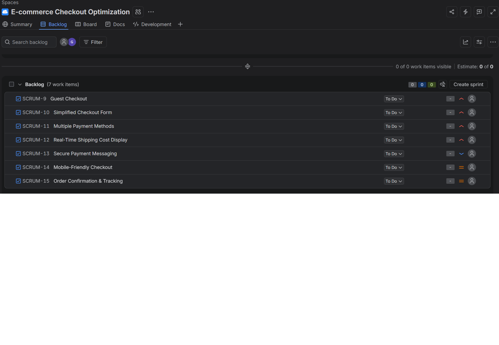
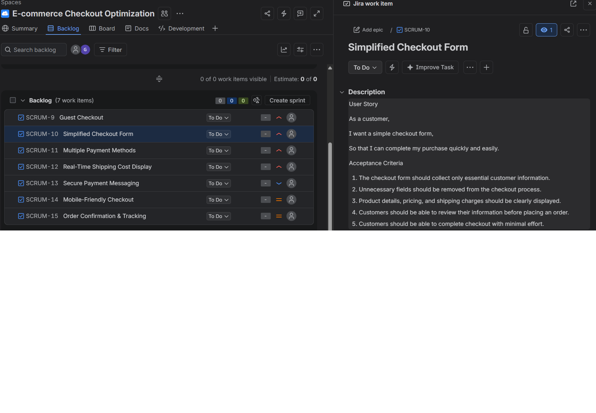

E-commerce Checkout Optimization (Business Analysis Project)

A business analysis project on reducing cart abandonment in an e-commerce checkout process.
What’s included: business goal and stakeholders, root cause analysis, 7 features with user stories and acceptance criteria, As-Is and To-Be process flows, backlog prioritization, 33 UAT test cases, and a Requirements Traceability Matrix.
Tools: Jira (Scrum backlog), Microsoft Word
Full documentation: see the PDF in this repository.

## Screenshots

